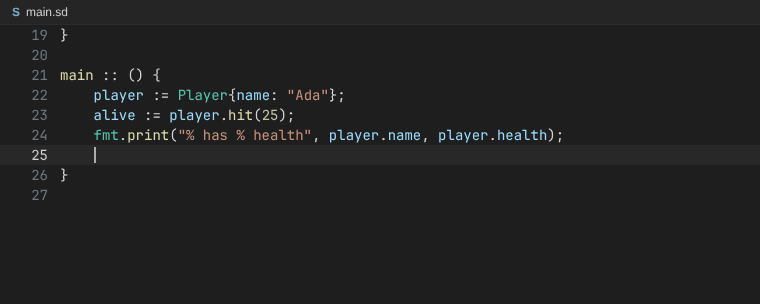
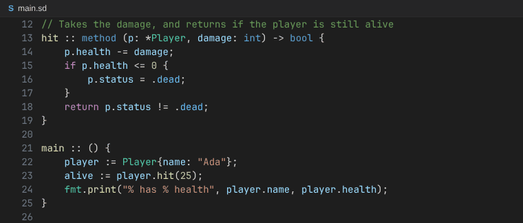

# The Saad language server

A language server for Saad, written in Saad. Any editor with an LSP client can use it, and `lsp/vscode` is the
extension for VS Code.

**Completion.** The fields and methods after a `.`, then the parameters of the call that is being written:


**Values from their context.** After `status == .`, `case .`, `x = .` or `f(.`, the values of the enum that is wanted:



**Hover.** The signature of a name and the `//` comment above its declaration:



The GIFs are drawn by `tools/linux/lsp_demo_gifs.js`: it types in a small program, asks the language server for the
completions, signatures, hovers and semantic tokens like an editor does, and draws the answers in the colors of VS
Code's dark theme.

Everything it does:

* errors and warnings while typing, also for text that isn't saved
* go to definition, find references and hover (the signature and the doc comment)
* the outline of a file, and the symbols of the workspace (Ctrl+T in VS Code)
* completion: the members after a `.`, the names in scope, the values of an enum or union after a `.` where the type is
  known (`status == .`, `case .`, `f(.`), and the fields of a struct literal that aren't written yet
* signature help: the parameters of the call that is being written
* semantic highlighting: names colored by what they are, e.g a struct, a field, a parameter or an enum value

The compiler does the work: the server runs `saad index` and answers from what it writes. See `docs/lsp.md`.

## Build

```
saad build lsp/main.sd          # lsp/build/out.exe
```

Usage: `out.exe --compiler path/to/saad.exe`. Without `--compiler`, it runs `saad` from the PATH. An editor can also
give the compiler as `initializationOptions.compilerPath`.

## VS Code

The extension is in `lsp/vscode`. It has the highlighting of Saad, an icon for `.sd` files (a blue "S", in
`lsp/vscode/icons`) and starts the server. VS Code shows the icon of a language when the file icon theme has no icon of
its own for the file, as with the default theme (Seti).

```
cd lsp/vscode
npm install
npx @vscode/vsce package         # saad-0.1.0.vsix
code --install-extension saad-0.1.0.vsix
```

Or open `lsp/vscode` in VS Code and press F5 to run it in a new window.

The extension finds the compiler and the server by itself when the Saad repository is open in VS Code: the compiler is
`bin/saad.exe` and the server is `lsp/build/out.exe`. When the server isn't built yet, it asks to build it
(`saad build lsp/main.sd`). For another project, set `saad.compilerPath` to the compiler, and the server is found in the
repository the compiler is in. Settings:

* `saad.compilerPath`: the compiler, e.g `C:/dev/Saad/bin/saad.exe`. Absolute, or relative to the workspace. By default
  `bin/saad.exe` of the workspace, or `saad` on the PATH.
* `saad.serverPath`: the server. By default `lsp/build/out.exe` of the repository the compiler is in, or of the
  workspace, or `saad-lsp` on the PATH.
* `saad.trace.server`: `messages` shows what VS Code and the server send each other, in the Output panel.

Commands: "Saad: Restart the language server", and "Saad: Build the language server", which stops the server, builds
it again and starts it, e.g after changing `lsp/`. The Output panel (Saad) shows where the extension looked for them.

## Other editors

Give the editor the command and the file type. In Neovim:

```lua
vim.filetype.add({ extension = { sd = "saad" } })
vim.lsp.start({ name = "saad", cmd = { "C:/dev/Saad/lsp/build/out.exe", "--compiler", "C:/dev/Saad/bin/saad.exe" },
                root_dir = vim.fs.root(0, { "main.sd", ".git" }) })
```

In Helix (`languages.toml`):

```toml
[language-server.saad]
command = "C:/dev/Saad/lsp/build/out.exe"
args = ["--compiler", "C:/dev/Saad/bin/saad.exe"]

[[language]]
name = "saad"
scope = "source.saad"
file-types = ["sd"]
language-servers = ["saad"]
```

## Testing on Linux

`tools/linux/build_lsp.sh` builds the server for Linux, and `tools/linux/check_lsp.py build/linux/saad-lsp` checks
it by talking to it like an editor. `tools/linux/runtests.sh` does both.
