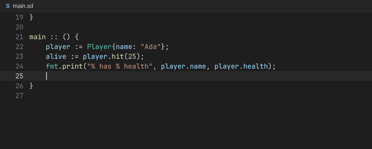
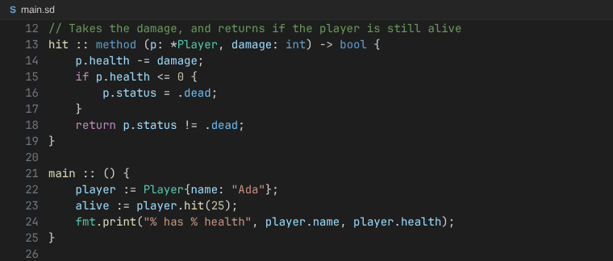

# The Saad language server

A language server for Saad, written in Saad. Any editor with an LSP client can use it, and `lsp/vscode` is the
extension for VS Code.

**Completion.** The fields and methods after a `.`, then the parameters of the call that is being written:



**Values from their context.** After `status == .`, `case .`, `x = .` or `f(.`, the values of the enum that is wanted:


**Hover.** The signature of a name and the `//` comment above its declaration:



The GIFs are drawn by `tools/linux/lsp_demo_gifs.js`: it types in a small program, asks the language server for the
completions, signatures, hovers and semantic tokens like an editor does, and draws the answers in the colors of VS
Code's dark theme.

Everything it does:

* errors and warnings while typing, also for text that isn't saved
* go to definition, find references and hover (the signature and the doc comment)
* the outline of a file, and the symbols of the workspace (Ctrl+T in VS Code)
* completion: the members after a `.`, the names in scope, the values of an enum or union after a `.` where the type is
  known (`status == .`, `case .`, `f(.`), the fields of a struct literal that aren't written yet, and the parameters of a
  call as named arguments (`fmt.print("hi", ne` gives `newline: `)
* signature help: the parameters of the call that is being written
* semantic highlighting: names colored by what they are, e.g a struct, a field, a parameter or an enum value
* rename (F2): a name where it is declared and everywhere it is used. A name of the standard library is renamed from a
  file of it, where all of its uses are known
* quick fix: the missing cases of a switch, for "The switch doesn't handle .closed of Status"

The compiler does the work: the server runs `saad index` and answers from what it writes. See `docs/lsp.md`.

## Build

```
saad build lsp/main.sd          # lsp/build/out.exe
```

Usage: `out.exe --compiler path/to/saad.exe`. Without `--compiler`, it runs `saad` from the PATH. An editor can also
give the compiler as `initializationOptions.compilerPath`.

## VS Code

The extension is in `lsp/vscode`. It has the highlighting of Saad, an icon for `.sd` files (a blue "S", in
`lsp/vscode/icons`) and starts the server. VS Code shows the icon of a language when the file icon theme has no icon of
its own for the file, as with the default theme (Seti).

Install **Saad** (`jakobsaadbye.saad`) from the Extensions view: it is on the Visual Studio Marketplace and on Open VSX
(for VSCodium and Cursor). VS Code updates it by itself.

[](https://github.com/jakobsaadbye/Saad/actions/workflows/vscode-extension.yml)
[](https://marketplace.visualstudio.com/items?itemName=jakobsaadbye.saad)
[](https://open-vsx.org/extension/jakobsaadbye/saad)

To publish a new version, raise `version` in `lsp/vscode/package.json` and add it to `lsp/vscode/CHANGELOG.md`. When it
is merged to `main`, `.github/workflows/vscode-extension.yml` publishes it to both. A version that is published already is
skipped. The workflow needs the secrets `VSCE_PAT` (Marketplace) and `OVSX_PAT` (Open VSX, optional) of the repository.

Whether a version went through is on GitHub, so there is no need to log in to the Marketplace:

* The run waits until the Marketplace has verified the version and gives it to everyone, which takes some minutes. A
  green check on the commit in `main` means the version is live; a red one means it wasn't verified in 30 minutes (see
  the publisher's page on the Marketplace for why).
* The summary of the run says, for each store, if it was published, live, or skipped (published already, or no token).
* Each store is an environment, `vscode-marketplace` and `open-vsx`, so **Deployments** on the repository's page lists
  every version that went live, with a link to the store.
* When the Marketplace has the version, the release `vscode-v<version>` is made, with the notes of `CHANGELOG.md` and
  the `.vsix`.

To try a change before it is published:

```
cd lsp/vscode
npm install
npx @vscode/vsce package    # saad-0.3.1.vsix
code --install-extension saad-0.3.1.vsix --force
```

Or open `lsp/vscode` in VS Code and press F5 to run it in a new window.

The extension finds the compiler and the server by itself when the Saad repository is open in VS Code: the compiler is
`bin/saad.exe` and the server is `lsp/build/out.exe`. When the server isn't built yet, it asks to build it
(`saad build lsp/main.sd`). For another project, set `saad.compilerPath` to the compiler, and the server is found in the
repository the compiler is in. Settings:

* `saad.compilerPath`: the compiler, e.g `C:/dev/Saad/bin/saad.exe`. Absolute, or relative to the workspace. By default
  `bin/saad.exe` of the workspace, or `saad` on the PATH.
* `saad.serverPath`: the server. By default `lsp/build/out.exe` of the repository the compiler is in, or of the
  workspace, or `saad-lsp` on the PATH.
* `saad.trace.server`: `messages` shows what VS Code and the server send each other, in the Output panel.

Commands: "Saad: Restart the language server", and "Saad: Build the language server", which stops the server, builds
it again and starts it, e.g after changing `lsp/`. The Output panel (Saad) shows where the extension looked for them.

## Other editors

Give the editor the command and the file type. In Neovim:

```lua
vim.filetype.add({ extension = { sd = "saad" } })
vim.lsp.start({ name = "saad", cmd = { "C:/dev/Saad/lsp/build/out.exe", "--compiler", "C:/dev/Saad/bin/saad.exe" },
                root_dir = vim.fs.root(0, { "main.sd", ".git" }) })
```

In Helix (`languages.toml`):

```toml
[language-server.saad]
command = "C:/dev/Saad/lsp/build/out.exe"
args = ["--compiler", "C:/dev/Saad/bin/saad.exe"]

[[language]]
name = "saad"
scope = "source.saad"
file-types = ["sd"]
language-servers = ["saad"]
```

## Testing on Linux

`tools/linux/build_lsp.sh` builds the server for Linux, and `tools/linux/check_lsp.py build/linux/saad-lsp` checks
it by talking to it like an editor. `tools/linux/runtests.sh` does both.
